# Study App Blueprint

A Hebrew and Greek reader for [Global Bible Tools](https://globalbibletools.com).

## System Overview
The Global Bible Tools Study App is an offline-capable, cross-platform Flutter application and dataset pipeline for studying biblical Hebrew and Greek texts. The repository contains the primary Flutter client (`lib`), platform host runners (`android`, `ios`, `macos`, `linux`, `windows`), a dedicated database compiler toolchain (`database_builder`), schema definitions (`assets/schemas`), and a local cloud testing harness (`ministack`).

```mermaid
graph TD
    subgraph UI ["Presentation Layer (lib/ui)"]
        HomeScreen["HomeScreen"]
        Panels["HebrewGreekPanel & BiblePanel"]
        AudioUI["BottomAudioPlayer"]
        RSUI["ReadingSheet & ProgressOverlays"]
    end

    subgraph Core ["Application Core (lib)"]
        AppState["AppState"]
        ServiceLocator["GetIt ServiceLocator"]
    end

    subgraph Services ["Service Infrastructure (lib/services)"]
        HGService["HebrewGreekDatabase"]
        BibleService["BibleService & BibleDatabase"]
        GlossService["GlossService"]
        LexService["LexiconsDatabase"]
        AudioService["AudioService & AudioTimingDatabase"]
        RSManager["ReadingSessionService & RSDB"]
        ResService["ResourceService & ResourceDatabase"]
        DownloadService["DownloadService"]
    end

    subgraph Storage ["SQLite Databases & Assets"]
        HG_DB[(hebrew_greek.db)]
        Bible_DB[(<translation>.db)]
        Gloss_DB[(<lang>.db)]
        Lex_DB[(sdbh.db / sdbg.db)]
        Audio_DB[(audio_timings.db)]
        RS_DB[(reading_session.db)]
        Res_DB[(resources.db)]
    end

    HomeScreen --> AppState
    Panels --> HGService
    Panels --> BibleService
    Panels --> GlossService
    Panels --> LexService
    AudioUI --> AudioService
    RSUI --> RSManager

    HGService --> HG_DB
    BibleService --> Bible_DB
    GlossService --> Gloss_DB
    LexService --> Lex_DB
    AudioService --> Audio_DB
    RSManager --> RS_DB
    ResService --> Res_DB

    ResService --> DownloadService
    DownloadService -.->|Fetch .part & atomic rename| Storage
```



## Subdirectories & System Boundaries
- **[lib](./lib/README.md)**: Main Flutter application package containing the user interface, state management, dependency injection, and data services.
- **[database_builder](./database_builder/README.md)**: Command-line Dart tool compiling raw USFM Scripture, Strong's mappings, UBS lexicon JSON datasets, and audio timing CSVs into optimized SQLite databases.
- **[assets](./assets/README.md)**: Static project assets and versioned SQLite migration schemas for reading session progress tracking.
- **[android](./android/README.md)**: Android application project hosting the Flutter engine via `MainActivity.kt`.
- **[ios](./ios/README.md)**: iOS platform runner wrapping the CocoaTouch `AppDelegate.swift` and plugin registrar.
- **[macos](./macos/README.md)**: macOS desktop runner managing the NSApplication lifecycle and Flutter view controller.
- **[linux](./linux/README.md)**: Linux GTK runner application hosting the Flutter Linux engine.
- **[windows](./windows/README.md)**: Windows Win32 runner application managing the main message pump and Flutter window.
- **[ministack](./ministack/README.md)**: Local S3 emulation container configuration and bucket initialization scripts for testing resource downloads.

## Global Invariants
- **Canonical Coordinate Bounds**: Scripture book identifiers are 1-based contiguous integers from 1 (Genesis) to 66 (Revelation).
- **Packed Verse Integer ID**: Verse reference keys are packed into 32-bit integers formatted as `BBCCCVVV` (`bookId * 1000000 + chapter * 1000 + verse`).
- **Language Testament Split**: Book ID 40 (Matthew) partitions biblical languages: books 1–39 are Hebrew/Aramaic (RTL text layout), and books 40–66 are Greek (LTR text layout).
- **Pinned Database Schema Versions**: SQLite databases validate internal schema revisions on startup (`hebrew_greek.db` version 13, `lexicon` version 2, `reading_session.db` version 3); outdated databases trigger automatic recreation or migrations.
- **Atomic File Download**: File downloads stream to temporary `.part` files prior to atomic file rename, ensuring offline storage integrity against partial network failures.

## Global Side Effects
- **Local SQLite Storage**: Reads and writes relational data to device SQLite database files within the application documents directory.
- **HTTP Resource Synchronization**: Downloads manifests, Bibles, glosses, and audio recordings from remote asset servers (`https://assets.globalbibletools.com` or local MiniStack endpoint).
- **Background Audio Lifecycle**: Manages system notification media controls and background audio playback using `JustAudioBackground`.
- **User Preferences**: Persists interface choices, font scales, reading session progress, and reading history via `SharedPreferences`.

## System Verification
- Run: `flutter test`

---

## Publishing tips

Android

```
flutter build appbundle
flutter build apk --split-per-abi
```

iOS

```
flutter build ipa
```

Open in Xcode:

```
build/ios/archive/Runner.xcarchive
```

## Licenses

The source code for this app is in the [public domain (CC0)](https://creativecommons.org/public-domain/cc0/) as stated in the [LICENSE](https://github.com/globalbibletools/study-app/blob/main/LICENSE) file.

However, the app also makes use of other resources that are not in the public domain:

- SBL Hebrew/Greek font. Non-commercial use allowed. See the license in the [assets/fonts](https://github.com/globalbibletools/study-app/tree/main/assets/fonts) folder.
- [UBS Dictionary of Biblical Hebrew/Greek](https://github.com/ubsicap/ubs-open-license/tree/main/dictionaries): [Creative Commons Attribution-ShareAlike 4.0 International License](https://creativecommons.org/licenses/by-sa/4.0/).

## Local development

The Flutter version is pinned with [FVM](https://fvm.app) in `.fvmrc`. Install the SDK with `fvm install`, then run Flutter commands through `fvm flutter`. If you use the Nix flake, Flutter is already provided, so FVM is not needed.

Run `docker compose up` to start ministack to be able to test asset downloads.
Assets stored in `ministack/assets` are available for the app to fetch.
