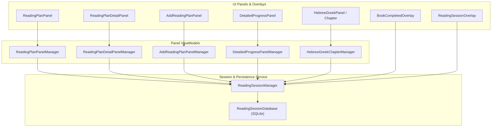
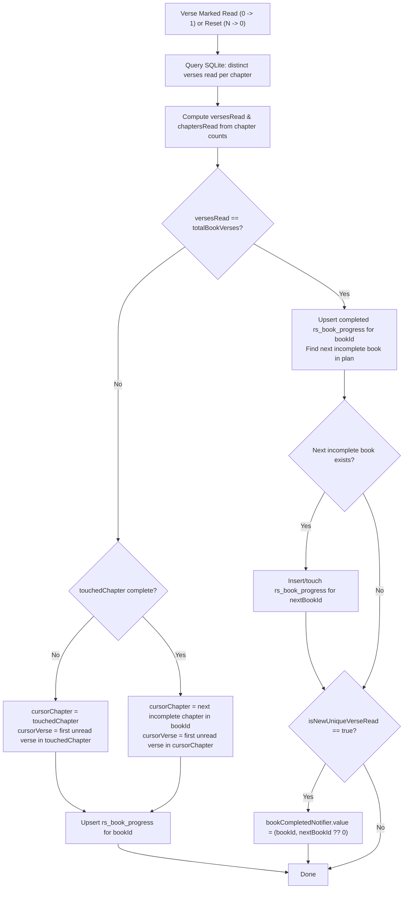

# Reading Session State Management Refactor & Reading Plan UI Fixes

*   **Author:** ethnosdev
*   **Status:** Approved
*   **Date:** 2026-11-05

--------------------------------------------------------------------------------

## Overview

The GBT study app includes a reading plan system that lets users choose a collection of Bible books, set a daily verse or time goal, track verse-by-verse reading progress in original-language texts, and monitor completion history on a monthly calendar. During recent user testing ([GBT update comments .pdf](../GBT%20update%20comments%20.pdf)), testers encountered six usability and correctness bugs across the reading plan workflow, alongside underlying state management defects in [`ReadingSessionManager`](../../lib/services/reading_session/rs_manager.dart).

This design refactors reading session state management so that the local SQLite database ([`ReadingSessionDatabase`](../../lib/services/reading_session/rs_database.dart)) serves as the single source of truth for book progress, chapter progress, and resume positions, while resolving all six reported UI, layout, and lifecycle bugs.

## The Problem

Users and developers currently face two intertwined categories of problems in the reading plan feature:

1.  **Premature Completion Popups, Broken Resume Positions, and Stale In-Memory State**:
    *   Finishing the first chapter of a multi-chapter book (such as Psalms 1) displays a modal overlay stating *"You've completed Psalms!"* because chapter completion is conflated with book completion.
    *   Even if that branch is patched, [`ReadingSessionManager._updateBookProgress`](../../lib/services/reading_session/rs_manager.dart#L539-L679) assumes users read every verse and chapter strictly in sequential order. Checking the final verse of a book (e.g., Psalm 150:6) before reading earlier chapters marks the book complete with only 1 of 2,461 verses read. Conversely, reading verses or chapters out of order prevents completion from firing when the final unread verse is checked and leaves the "Resume Reading" cursor pointing at an already-read verse.
    *   Book and chapter progress counters are mutated incrementally (`+= 1` / `-= 1`) in memory and cached across separate manager classes that write directly to SQLite without notifying [`ReadingSessionManager`](../../lib/services/reading_session/rs_manager.dart). As a result, resetting a verse after 10 reads fails to decrement completed chapters or clear reads from earlier sessions, restoring a backup leaves pre-restore book progress in memory, editing a plan resets custom book ordering and leaves active sessions running against stale goals, and starting a second plan while a session is active silently logs verses to the old plan.
2.  **UI Layout, Visual Consistency, and Plan Lifecycle Gaps**:
    *   **Bottom Sheet Gesture Conflict on Android**: The reading plans modal bottom sheet ([`ReadingSheet`](../../lib/ui/home/reading_plan/reading_sheet.dart)) hosts an unconstrained `Navigator` that expands to 100% of the screen height and top-aligns its child container under the status bar. When users try to drag the top handle down, the swipe triggers the Android notification shade instead.
    *   **Calendar Checkmark Overlap**: In [`CalendarView`](../../lib/ui/home/panel_area/common/calendar_view.dart), a centered `42dp` checkmark overlaps the date number in the top-left corner of each day cell.
    *   **Inconsistent Action Buttons and Labels**: "Resume Reading", "Add Reading Plan", and "Update Reading Plan" render as dark outlined buttons instead of the solid teal fill used for primary call-to-action buttons. In addition, "Add Reading Plan" on the creation form confuses users into thinking it creates an additional plan rather than saving the current one, and "Update Reading Plan" displays a `+` icon instead of a checkmark.
    *   **No Way to Delete Reading Plans**: Users who create a reading plan by mistake or change their mind have no UI or database mechanism to delete the plan and its associated progress records.

## Goals

*   **Accurate Book Completion**: Trigger [`BookCompletedOverlay`](../../lib/ui/home/panel_area/common/book_completed_overlay.dart) if and only if marking a previously unread verse causes all verses in that book to be marked read at least once (`versesRead == BibleNavigation.getTotalVerseCount(bookId)` in [`BibleNavigation`](../../lib/common/bible_navigation.dart)), regardless of the order in which chapters or verses were read. Include a dismiss button when completing the final book in a plan.
*   **Deterministic First-Unread-Verse Resume Cursor**: Always advance a book's saved resume position (`chapter`, `verse`) to the first unread verse in the current chapter, or the first unread verse of the next incomplete chapter in that book, or the next incomplete book in the plan's custom book order.
*   **SQLite Single Source of Truth & Synchronized Session State**: Derive `versesRead` and `chaptersRead` directly from `rs_log` in SQLite, scope in-memory chapter caches by `(readingPlanId, bookId, chapter)`, clear all caches on backup restore, and route all plan create/edit/reorder/bookmark/delete operations through [`ReadingSessionManager`](../../lib/services/reading_session/rs_manager.dart) so active sessions stay synchronized or terminate when their plan is deleted.
*   **Preserve Custom Book Order on Edit**: Retain user-defined book ordering (`ord`) for existing books when updating a reading plan's settings or book selection.
*   **Cross-Session Verse Reset**: Ensure resetting a verse after reaching `maximumReadCount` (10) removes all `rs_log` entries for that verse across prior sessions for that plan while adjusting today's daily log count only for reads logged in the current session.
*   **Transactional Reading Plan Deletion**: Provide a delete action (guarded by a shared confirmation dialog) in both the reading plan list edit mode and the edit plan screen that ends any active session for that plan and deletes all dependent records across all six reading session tables in a single SQLite transaction.
*   **Bottom Sheet & UI Ergonomics**: Constrain [`ReadingSheet`](../../lib/ui/home/reading_plan/reading_sheet.dart) to 85% of screen height with `useSafeArea: true` so the drag handle stays below the Android status bar; separate date numbers and checkmarks in [`CalendarView`](../../lib/ui/home/panel_area/common/calendar_view.dart); and standardize solid teal primary buttons with `"Save Reading Plan"`, `"Update Reading Plan"`, and checkmark icons.

## Non-Goals

*   **Single-Tap Verse Uncheck**: Adding a new UI interaction to uncheck a verse before it reaches `maximumReadCount` (10) is out of scope.
*   **Third-Party State Management Migration**: Replacing the app's `GetIt` + `ValueNotifier` architecture with Riverpod, Bloc, or Provider is out of scope.
*   **Database Schema Migration**: Changing table definitions in [`assets/schemas/reading_session.sql`](../../assets/schemas/reading_session.sql) or bumping the SQLite database version is out of scope, as all required queries and cascading deletes operate on the existing schema.

## Open Questions

*   None. All requirements and edge-case behaviors were resolved during the brainstorming phase.

## Critical User Journeys (CUJs)

### CUJ 1: Completing Chapter 1 vs. Completing an Entire Book (In-Order or Out-of-Order)

*   **Given**: A user has an active reading session for a plan containing Psalms (150 chapters, 2,461 verses) followed by Proverbs.
*   **When**: The user marks all 6 verses of Psalms 1 as read.
*   **Then**: `chaptersRead` for Psalms increments to 1, `versesRead` increments to 6, the resume cursor advances to Psalms 2:1, and [`BookCompletedOverlay`](../../lib/ui/home/panel_area/common/book_completed_overlay.dart) does **not** appear.
*   **When**: The user later marks the final remaining unread verse of Psalms (even if that verse is in Psalms 149 after Psalms 150 was already read).
*   **Then**: `versesRead` reaches 2,461, `chaptersRead` reaches 150, [`BookCompletedOverlay`](../../lib/ui/home/panel_area/common/book_completed_overlay.dart) appears announcing *"You've completed Psalms!"* with a button to advance to Proverbs, and the plan's active book cursor advances to Proverbs.

### CUJ 2: Resuming Reading After Partial or Out-of-Order Progress

*   **Given**: A user is reading Psalms 1 (6 verses) in an active plan and marks verses 1, 2, and 6 as read, leaving verses 3, 4, and 5 unread.
*   **When**: The user closes the app or switches chapters and later taps **"Resume Reading"** on the plan.
*   **Then**: The app navigates to Psalms 1:3 (the first unread verse in the chapter), not Psalms 2:1.

### CUJ 3: Editing or Deleting a Reading Plan While a Session Is Active

*   **Given**: A user has an active reading session running for Plan A.
*   **When**: The user opens the Reading Plans sheet, edits Plan A to change its daily goal or book list, and taps **"Update Reading Plan"** (solid teal button with a checkmark icon).
*   **Then**: Plan A's custom book order is preserved for retained books, [`ReadingSessionManager`](../../lib/services/reading_session/rs_manager.dart) immediately reloads Plan A's updated goal and book set, and the active session overlay reflects the new goal without restarting the app.
*   **When**: The user instead taps the delete icon on Plan A and confirms deletion in the alert dialog.
*   **Then**: [`ReadingSessionManager`](../../lib/services/reading_session/rs_manager.dart) stops the active session timer, hides the reading session overlay, removes all records for Plan A across all six SQLite tables in a single transaction, and refreshes the reading plans list.

### CUJ 4: Dragging the Reading Plans Bottom Sheet on Android

*   **Given**: A user on an Android device opens the Reading Plans bottom sheet from the home screen.
*   **When**: The sheet opens and the user drags the top handle downward to dismiss it.
*   **Then**: The sheet's top edge and drag handle sit 15% below the top of the screen (well clear of the Android status bar), and swiping down dismisses the bottom sheet without pulling down the Android notification shade.

## Technical Plan (Architecture)

### 1. Component Boundaries & Data Flow

Currently, the four reading plan UI managers ([`ReadingPlanPanelManager`](../../lib/ui/home/reading_plan/reading_plan_panel_manager.dart), [`ReadingPlanDetailPanelManager`](../../lib/ui/home/reading_plan/reading_plan_detail_panel_manager.dart), [`AddReadingPlanPanelManager`](../../lib/ui/home/reading_plan/add_reading_plan_panel_manager.dart), and [`DetailedProgressPanelManager`](../../lib/ui/home/reading_plan/detailed_progress_panel_manager.dart)) hold direct references to [`ReadingSessionDatabase`](../../lib/services/reading_session/rs_database.dart) via `GetIt` and mutate SQLite tables bypassing [`ReadingSessionManager`](../../lib/services/reading_session/rs_manager.dart).

To prevent split-brain state between in-memory caches and SQLite, [`ReadingSessionManager`](../../lib/services/reading_session/rs_manager.dart) becomes the single facade for all reading plan and reading session operations. UI panel managers interact only with [`ReadingSessionManager`](../../lib/services/reading_session/rs_manager.dart), and [`ReadingSessionManager`](../../lib/services/reading_session/rs_manager.dart) owns all interactions with [`ReadingSessionDatabase`](../../lib/services/reading_session/rs_database.dart).



### 2. SQLite-Backed Book Progress & Deterministic Resume Cursor

Instead of mutating `versesRead` and `chaptersRead` incrementally in memory, book progress is recomputed deterministically from `rs_log` whenever a verse's unique read state changes (first time read `0 -> 1`, or reset `N -> 0`):

1.  **SQLite Chapter Aggregation**:
    [`ReadingSessionDatabase`](../../lib/services/reading_session/rs_database.dart) aggregates distinct verses read per chapter for the given `(readingPlanId, bookId)` from `rs_log`.
2.  **Exact `versesRead` and `chaptersRead` Derivation**:
    Using canonical chapter and verse counts from [`BibleNavigation`](../../lib/common/bible_navigation.dart), `versesRead` is the sum of distinct read verses across all chapters of `bookId`, and `chaptersRead` is the number of chapters whose distinct read verse count equals the chapter's total verse count.
3.  **First-Unread-Verse Resume Cursor Calculation**:
    *   **Case A — Current chapter still has unread verses**: Keep the resume cursor in the current chapter and set `verse` to the lowest unread verse number in that chapter.
    *   **Case B — Current chapter is 100% read, but the book has unread verses**: Scan forward through the remaining chapters of `bookId` (wrapping around to chapter 1) to find the first incomplete chapter, and set the resume cursor to the lowest unread verse in that chapter.
    *   **Case C — Entire book is 100% read**:
        *   Set `bookId`'s cursor to its final chapter and verse and persist its completed `RsBookProgress` row.
        *   Scan forward in the plan's ordered book list (wrapping around to index `0`) to find the next incomplete book (`nextBookId`) by checking the plan's pre-populated 66-book progress list (where unstarted books have placeholder entries with `id == null` and `versesRead == 0`).
        *   If `nextBookId` exists, initialize its progress row at `(chapter: 1, verse: 1)` if unstarted (`id == null`) or refresh its `updatedAt` timestamp while preserving its existing `(chapter, verse)` if already partially read, making `nextBookId` the most recently updated incomplete book in the plan.
        *   If this update was triggered by marking a previously unread verse (`isNewUniqueVerseRead == true`), emit `(bookId, nextBookId ?? 0)` on `bookCompletedNotifier`.



### 3. Fixing Cache Keys, Verse Reset Across Sessions, and Active Book Selection

*   **Plan-Scoped Chapter Cache**:
    Scope the in-memory chapter verse read cache in [`ReadingSessionManager`](../../lib/services/reading_session/rs_manager.dart) by `(readingPlanId, bookId, chapter)` instead of packing only `(bookId, chapter)` so switching plans never serves stale verse counts from another plan.
*   **Complete Cache Clearing on Restore**:
    When restoring from a backup, clear the in-memory book progress cache alongside the chapter and monthly caches so UI panels immediately reflect restored database state.
*   **Cross-Session Verse Reset**:
    When a user resets a verse after reaching `maximumReadCount` (10), count how many reads of that verse belong to the active daily session, delete all `rs_log` rows for that verse across all sessions in the active plan, subtract only the current session's reads from the active daily log, and recompute book progress from SQLite. Closed historical sessions (`rs_daily_log` with `end_time IS NOT NULL` and `rs_stats`) remain immutable records of past daily activity.
*   **Plan-Aware Active Book Selection**:
    Filter candidate resume books to those belonging to the plan and prefer incomplete books ordered by most recent `updatedAt`, falling back to the most recently updated completed book only when all books in the plan are complete.

### 4. Active Session Lifecycle on Plan Edit, Reorder, Switch, and Delete

All plan mutations are executed through [`ReadingSessionManager`](../../lib/services/reading_session/rs_manager.dart):

*   **Creating or Updating a Plan**:
    *   Preserve existing `ord` values for retained books and append newly selected books at the end in default collection order.
    *   Persist plan metadata, book mappings, and removal of `rs_book_progress` rows for deselected books atomically in a single SQLite transaction. Historical `rs_log` rows for deselected books are intentionally retained so verse history is preserved if the user re-adds the book later.
    *   If the edited plan is currently active in a reading session, reload its details, book list, and book progress cache, re-evaluate daily goal completion against the updated threshold, and trigger a notifier refresh so [`ReadingSessionOverlay`](../../lib/ui/home/panel_area/common/reading_session_overlay.dart) and [`HebrewGreekPanel`](../../lib/ui/home/panel_area/hebrew_greek_panel/panel.dart) rebuild immediately.
*   **Reordering Books**:
    *   Batch-update `reading_plan_book.ord` in a single SQLite transaction and mutate the in-memory book lists in place so both active sessions and open detail panels reflect the new order immediately.
*   **Switching Active Plans**:
    *   If a different reading plan is already active when starting a session, await `endReadingSession()` to persist and close the previous plan's session before starting the new plan.
*   **Deleting a Plan**:
    *   If the deleted plan is currently active, reset active session state via `_resetBeforeRestore()` without logging session stats for the deleted plan.
    *   Delete all rows for the plan across `rs_log`, `rs_daily_log`, `rs_stats`, `rs_book_progress`, `reading_plan_book`, and `reading_plan` in child-to-parent order inside a single SQLite transaction, and purge in-memory caches for that plan.

### 5. Modal Bottom Sheet Layout & UI Refinements

*   **Bottom Sheet Height Constraint**:
    Constrain [`ReadingSheet`](../../lib/ui/home/reading_plan/reading_sheet.dart) to 85% of screen height and enable `useSafeArea: true` on the modal bottom sheet so the nested `Navigator` is anchored to the bottom 85% of the screen, keeping the top drag handle clear of the Android status bar while providing bounded vertical constraints to all child panels (including [`AddReadingPlanPanel`](../../lib/ui/home/reading_plan/add_reading_plan_panel.dart) when its numeric keypad is shown).
*   **Calendar Checkmark Separation**:
    Position the date number in the top-left corner and a smaller completion checkmark in the bottom-right corner of each [`CalendarView`](../../lib/ui/home/panel_area/common/calendar_view.dart) cell so they never overlap.
*   **Primary CTA Button Styling & Iconography**:
    Standardize primary action buttons ("Start Reading", "Resume Reading", "Save Reading Plan", and "Update Reading Plan") on solid primary teal fill with white foreground text/icons, and use a checkmark icon for saving or updating a plan.
*   **Reading Plan Deletion UI**:
    Provide a shared confirmation dialog invoked from a delete icon button on each plan card in [`ReadingPlanPanel`](../../lib/ui/home/reading_plan/reading_plan_panel.dart) edit mode and in the header bar of [`AddReadingPlanPanel`](../../lib/ui/home/reading_plan/add_reading_plan_panel.dart) when editing an existing plan.
*   **Final-Book Completion Dismiss & Next-Book Navigation**:
    Render a `"Done"` button in [`BookCompletedOverlay`](../../lib/ui/home/panel_area/common/book_completed_overlay.dart) when `newBookId == 0`, and navigate to the next book's saved `(chapter, verse)` cursor in [`BiblePanelArea.onNextBook`](../../lib/ui/home/panel_area/panel_area.dart).

## Alternatives Considered

### Alternative A: Patch Only the `else if (chapterCompleted)` Branch in `_updateBookProgress`

*   **Pros**:
    *   Requires changing only a single line in [`ReadingSessionManager._updateBookProgress`](../../lib/services/reading_session/rs_manager.dart#L671).
    *   Prevents the book completion overlay from appearing after finishing chapter 1 of a multi-chapter book when reading sequentially.
*   **Cons**:
    *   Still triggers a false book completion overlay if a user jumps to the final verse of a book (such as Psalm 150:6) and checks it before reading earlier chapters (`nextChapter.bookId != bookId`).
    *   Fails to trigger book completion when a user finishes chapters or verses out of order (for example, completing Psalm 149 after Psalm 150 was already read).
    *   Leaves incremental counter drift (`chaptersRead` never decrementing on verse reset) and stale resume cursors unaddressed.
*   **Reason for Rejection**: Rejected because it relies on the false assumption that users only read verses and chapters in strict sequential order from 1 to N.

### Alternative B: Only Change `SafeArea(top: true)` Inside `ReadingPlanPanel` for the Bottom Sheet Handle

*   **Pros**:
    *   Touches only the `SafeArea` parameter in [`ReadingPlanPanel`](../../lib/ui/home/reading_plan/reading_plan_panel.dart#L55-L58) and [`ReadingPlanDetailPanel`](../../lib/ui/home/reading_plan/reading_plan_detail_panel.dart#L68-L71).
*   **Cons**:
    *   Does not fix why the sheet container was placed at `y = 0` in the first place: [`ReadingSheet`](../../lib/ui/home/reading_plan/reading_sheet.dart#L11-L21) returns an unconstrained `Navigator` inside `showModalBottomSheet(isScrollControlled: true)`, causing `Navigator`'s `Overlay` to expand to 100% of screen height and top-align the `0.85 * screenHeight` container at the top of the screen while leaving 15% dead space at the bottom.
*   **Reason for Rejection**: Rejected because constraining [`ReadingSheet`](../../lib/ui/home/reading_plan/reading_sheet.dart) itself to 85% of screen height (alongside `useSafeArea: true`) is required to keep the bottom sheet anchored to the bottom 85% of the screen.

### Alternative C: Introduce a Third-Party State Management Framework (Riverpod or Bloc)

*   **Pros**:
    *   Provides built-in dependency graph invalidation and stream-based state propagation.
*   **Cons**:
    *   Introduces a new architectural paradigm and external package dependency into an app that uniformly uses `GetIt` singletons and `ValueNotifier` / `ChangeNotifier`.
    *   Requires rewriting unrelated UI layers without solving the underlying SQLite vs. in-memory data duplication unless the SQL queries themselves are fixed.
*   **Reason for Rejection**: Rejected because the state bugs stem from bypassing [`ReadingSessionManager`](../../lib/services/reading_session/rs_manager.dart) and computing progress via incremental in-memory math rather than any limitation of `GetIt` and `ValueNotifier`.

--------------------------------------------------------------------------------

## Non-Functional Requirements

*   **Performance & Latency**:
    *   Without a schema migration, `rs_log` does not have a composite index on `(reading_plan_id, book_id, chapter, verse)`, so aggregating distinct verses per chapter or deleting logs for a reset verse performs a table scan bounded by the user's total logged verse rows in local SQLite. These queries run only on explicit user verse-tap or verse-reset actions.
    *   All multi-statement plan mutations (`saveReadingPlan`, `reorderReadingPlanBooks`, `deleteReadingPlan`) run inside a single SQLite transaction (`_database.transaction`) with batch execution (`txn.batch()`) to avoid main-thread frame drops and prevent partial writes if interrupted.
*   **Backward Compatibility & Data Integrity**:
    *   No schema migration is required; existing `reading_session.db` files and JSON backup archives (`format_version = 1` and `format_version = 2` in [`BackupExporter`](../../lib/services/backup_restore/backup_exporter.dart) and [`BackupImporter`](../../lib/services/backup_restore/backup_importer.dart)) remain compatible without migration.
    *   Existing plans whose cached `rs_book_progress` counters had drifted will self-heal the next time any verse in that book is marked or reset.

## Risks & Mitigations

*   **Risk 1: Unindexed `rs_log` Table Scans as Reading History Grows**:
    *   *Risk*: Because schema changes are out of scope for this change, queries filtering `rs_log` by `(reading_plan_id, book_id)` perform a sequential scan of `rs_log`.
    *   *Mitigation*: Queries only execute when a verse's unique read state transitions (`0 -> 1` or `10 -> 0`), keeping per-tap overhead imperceptible for typical local database sizes (`< 50,000` rows). Adding a composite index `CREATE INDEX idx_rs_log_plan_book ON rs_log(reading_plan_id, book_id, chapter, verse)` is tracked under Future Improvements for the next schema version bump.
*   **Risk 2: Historical Session Immutability When Resetting a Verse Across Sessions**:
    *   *Risk*: Resetting a verse at `maximumReadCount` (10) deletes `rs_log` rows that may have been recorded on previous days, which could create a difference between historical `rs_daily_log.verses` totals and current `rs_book_progress.verses_read`.
    *   *Mitigation*: By design, `rs_log` and `rs_book_progress` represent current book/chapter completion state for the plan, whereas closed `rs_daily_log` (`end_time IS NOT NULL`) and `rs_stats` rows represent immutable historical logs of daily reading activity. Only the currently open daily session (`_rsDailyLog`) is decremented by `todaySessionCount`.
*   **Risk 3: Deselecting the Currently Open Book While Editing an Active Plan**:
    *   *Risk*: A user could edit the currently active reading plan and remove the book currently displayed in [`HebrewGreekPanel`](../../lib/ui/home/panel_area/hebrew_greek_panel/panel.dart), then tap a verse in that panel.
    *   *Mitigation*: `saveReadingPlan` reloads `_booksProgress` and toggles `readingModeNotifier` (`false` -> `true`) so [`HebrewGreekPanel`](../../lib/ui/home/panel_area/hebrew_greek_panel/panel.dart) immediately hides verse checkboxes for books no longer in `_books`. In addition, `markVerseAsRead` and `resetReadingCountForVerse` guard that `_books != null && _books!.contains(bookId)` before logging or resetting verses.

--------------------------------------------------------------------------------

## Additional Resources

*   [GBT update comments .pdf](../GBT%20update%20comments%20.pdf) — Original tester screenshots and annotations.
*   [reading_plan_bugs_and_improvements.md](../reading_plan_bugs_and_improvements.md) — Detailed bug breakdown and state management audit.

## Future Improvements

*   **Single-Tap Verse Uncheck**: Add a dedicated UI gesture (such as long-pressing the verse checkbox or tapping a checked verse when `maximumReadCount == 1`) so users can uncheck an accidentally tapped verse without cycling through 10 taps.
*   **Composite Index on `rs_log`**: Add `CREATE INDEX idx_rs_log_plan_book ON rs_log(reading_plan_id, book_id, chapter, verse)` in [`assets/schemas/reading_session.sql`](../../assets/schemas/reading_session.sql) during the next SQLite schema version migration.

--------------------------------------------------------------------------------

## Detailed Implementation Plan

The implementation is partitioned into four incremental phases. Each phase leaves the codebase in a buildable, analyzer-clean state.

### Phase 1: Localization & SQLite / Service Layer Refactor

#### 1. Localization Resource Files & Generated Classes (Modify)

*   [`lib/l10n/app_en.arb`](../../lib/l10n/app_en.arb) (Modify)
*   [`lib/l10n/app_es.arb`](../../lib/l10n/app_es.arb) (Modify)
*   [`lib/l10n/app_fr.arb`](../../lib/l10n/app_fr.arb) (Modify)
*   [`lib/l10n/app_pt.arb`](../../lib/l10n/app_pt.arb) (Modify)
*   [`lib/l10n/app_ar.arb`](../../lib/l10n/app_ar.arb) (Modify)
*   **Type / Scope**: Localization Strings (`flutter gen-l10n`)
*   **Rationale & Proposed Changes**:
    *   Update `addReadingPlan` and add `deleteReadingPlan`, `deleteReadingPlanConfirmTitle`, and `deleteReadingPlanConfirmMessage(String name)` across all 5 locale ARB files:
        *   **English (`app_en.arb`)**:
            *   `"addReadingPlan": "Save Reading Plan"`
            *   `"deleteReadingPlan": "Delete Reading Plan"`
            *   `"deleteReadingPlanConfirmTitle": "Delete Reading Plan?"`
            *   `"deleteReadingPlanConfirmMessage": "Are you sure you want to delete \"{name}\"? All reading progress for this plan will be permanently removed."` (with `@deleteReadingPlanConfirmMessage` placeholder `"name": {"type": "String"}`)
        *   **Spanish (`app_es.arb`)**:
            *   `"addReadingPlan": "Guardar plan de lectura"`
            *   `"deleteReadingPlan": "Eliminar plan de lectura"`
            *   `"deleteReadingPlanConfirmTitle": "¿Eliminar plan de lectura?"`
            *   `"deleteReadingPlanConfirmMessage": "¿Estás seguro de que quieres eliminar \"{name}\"? Todo el progreso de lectura de este plan se eliminará permanentemente."`
        *   **French (`app_fr.arb`)**:
            *   `"addReadingPlan": "Enregistrer le plan de lecture"`
            *   `"deleteReadingPlan": "Supprimer le plan de lecture"`
            *   `"deleteReadingPlanConfirmTitle": "Supprimer le plan de lecture ?"`
            *   `"deleteReadingPlanConfirmMessage": "Voulez-vous vraiment supprimer « {name} » ? Toute la progression de lecture de ce plan sera définitivement supprimée."`
        *   **Portuguese (`app_pt.arb`)**:
            *   `"addReadingPlan": "Salvar plano de leitura"`
            *   `"deleteReadingPlan": "Excluir plano de lectura"` -> `"Excluir plano de leitura"`
            *   `"deleteReadingPlanConfirmTitle": "Excluir plano de leitura?"`
            *   `"deleteReadingPlanConfirmMessage": "Tem certeza de que deseja excluir \"{name}\"? Todo o progresso de leitura deste plano será removido permanentemente."`
        *   **Arabic (`app_ar.arb`)**:
            *   `"addReadingPlan": "حفظ خطة القراءة"`
            *   `"deleteReadingPlan": "حذف خطة القراءة"`
            *   `"deleteReadingPlanConfirmTitle": "هل تريد حذف خطة القراءة؟"`
            *   `"deleteReadingPlanConfirmMessage": "هل أنت متأكد أنك تريد حذف \"{name}\"؟ سيتم إزالة كل تقدم القراءة لهذه الخطة نهائياً."`
    *   Run `flutter gen-l10n` to regenerate `lib/l10n/app_localizations*.dart`.

#### 2. [`lib/services/reading_session/rs_database.dart`](../../lib/services/reading_session/rs_database.dart) (Modify)

*   **Type / Scope**: SQLite Persistence Service
*   **Rationale & Proposed Changes**:
    *   Add `Future<Map<int, int>> getDistinctVersesReadPerChapter(int readingPlanId, int bookId)` executing:
        ```sql
        SELECT chapter, COUNT(DISTINCT verse) AS count
        FROM rs_log
        WHERE reading_plan_id = ? AND book_id = ?
        GROUP BY chapter
        ```
    *   Add `Future<int> deleteRsLogsForVerse(int readingPlanId, int bookId, int chapter, int verse)` executing:
        ```sql
        DELETE FROM rs_log
        WHERE reading_plan_id = ? AND book_id = ? AND chapter = ? AND verse = ?
        ```
    *   Add `Future<ReadingPlanDetails?> getReadingPlanById(int planId)` to fetch a single `ReadingPlan` and its ordered `ReadingPlanBook` list.
    *   Add `Future<ReadingPlan> saveReadingPlan({ReadingPlan? existingPlan, required String planName, required int collectionId, required String goalType, required int goalValue, required List<int> orderedBookIds})` executing inside `_database.transaction((txn) async { ... })`:
        *   Insert a new `ReadingPlan` (obtaining `planId`) or update `existingPlan` (`planId = existingPlan.id!`).
        *   Delete existing `reading_plan_book` rows for `planId`, then batch-insert `ReadingPlanBook(readingPlanId: planId, bookId: orderedBookIds[i], ord: i + 1)` for `i` in `0 .. orderedBookIds.length - 1`.
        *   If `existingPlan != null`, delete `rs_book_progress` rows for `planId` whose `book_id` is not in `orderedBookIds`.
    *   Change `void updateReadingPlanBooks(List<ReadingPlanBook> books) async` to `Future<void> updateReadingPlanBooks(List<ReadingPlanBook> books) async` and execute updates via `_database.transaction` batching so callers can await completion.
    *   Add `Future<void> deleteReadingPlan(int planId)` executing a single `_database.transaction` batch delete in child-to-parent dependency order:
        `rs_log` -> `rs_daily_log` -> `rs_stats` -> `rs_book_progress` -> `reading_plan_book` -> `reading_plan`.

#### 3. [`lib/services/reading_session/rs_manager.dart`](../../lib/services/reading_session/rs_manager.dart) (Modify)

*   **Type / Scope**: Session & Reading Plan State Coordinator
*   **Rationale & Proposed Changes**:
    *   Change `_bookVerseReadCount` from `Map<int, Map<int, int>>` to `Map<(int, int, int), Map<int, int>>` keyed by `(readingPlanId, bookId, chapter)`.
    *   Update `_resetBeforeRestore()` to also set `_books = null` and `bookCompletedNotifier.value = (0, 0)`, and update `_reloadFromDatabase()` to also call `_booksProgress.clear()`.
    *   Add synchronous `RsBookProgress? getBookProgressForActivePlan(int bookId)` returning `_booksProgress[_readingPlan?.readingPlan.id]?[bookId - 1]` when `id != null`, or `null` if unstarted.
    *   In `markVerseAsRead` and `resetReadingCountForVerse`, guard that `_readingPlan != null && _books != null && _books!.contains(bookId)` before mutating state.
    *   Update `startReadingSession(ReadingPlanDetails readingPlan)`:
        *   If `_readingPlan != null`:
            *   If `_readingPlan!.readingPlan.id == readingPlan.readingPlan.id`, update `_readingPlan = readingPlan`, `_books = readingPlan.books.map((e) => e.bookId).toSet()`, and toggle `readingModeNotifier.value = false; readingModeNotifier.value = true;` before returning.
            *   Otherwise, call `await endReadingSession()` before starting the new plan's session.
    *   Replace `_updateBookProgress` with `Future<void> _recomputeBookProgress(int readingPlanId, int bookId, int touchedChapter, {required bool isNewUniqueVerseRead})`:
        *   Ensure `await loadBooksProgress(readingPlanId)` has populated `_booksProgress[readingPlanId]` (a 66-element list indexed by `bookId - 1`).
        *   Query `chapterCounts = await _rsdbManager.getDistinctVersesReadPerChapter(readingPlanId, bookId)`.
        *   Compute `totalBookChapters = BibleNavigation.getChapterCount(bookId)` and `totalBookVerses = BibleNavigation.getTotalVerseCount(bookId)`.
        *   Compute `versesRead` as the sum of `chapterCounts.values` and `chaptersRead` as the count of chapters `c` in `1..totalBookChapters` where `(chapterCounts[c] ?? 0) == BibleNavigation.getVerseCount(bookId, c)`.
        *   Compute cursor `(cursorChapter, cursorVerse)`:
            *   **Case A (`(chapterCounts[touchedChapter] ?? 0) < BibleNavigation.getVerseCount(bookId, touchedChapter)`)**: `cursorChapter = touchedChapter`, and `cursorVerse` is the lowest verse `v` in `1..BibleNavigation.getVerseCount(bookId, touchedChapter)` with `(versesReadMap[v] ?? 0) == 0` from `_rsdbManager.getVersesReadForChapter(readingPlanId, bookId, touchedChapter)`.
            *   **Case B (`versesRead < totalBookVerses`)**: scan `c` in `[touchedChapter + 1 .. totalBookChapters, 1 .. touchedChapter - 1]` for the first chapter where `(chapterCounts[c] ?? 0) < BibleNavigation.getVerseCount(bookId, c)`, set `cursorChapter = c`, and set `cursorVerse` to the lowest unread verse in chapter `c`.
            *   **Case C (`versesRead == totalBookVerses`)**:
                *   Set `cursorChapter = totalBookChapters` and `cursorVerse = BibleNavigation.getVerseCount(bookId, totalBookChapters)`.
                *   Upsert `bookId`'s completed `RsBookProgress` row in `rs_book_progress` and `_booksProgress[readingPlanId]![bookId - 1]`.
                *   Find `nextBookId` by locating `bookId` in `_readingPlan!.books` (defaulting start index to `0` if absent) and scanning forward (wrapping around to `0`) for the first `candidateBookId` where `_booksProgress[readingPlanId]![candidateBookId - 1].versesRead < BibleNavigation.getTotalVerseCount(candidateBookId)`.
                *   If `nextBookId != null`: if `_booksProgress[readingPlanId]![nextBookId - 1].id == null`, insert `RsBookProgress(readingPlanId: readingPlanId, bookId: nextBookId, chapter: 1, verse: 1, chaptersRead: 0, versesRead: 0, updatedAt: DateTime.now())` and store the returned `id`; otherwise update its `updatedAt: DateTime.now()` in SQLite and `_booksProgress`.
                *   If `isNewUniqueVerseRead == true`, set `bookCompletedNotifier.value = (bookId, nextBookId ?? 0)`.
        *   Call `await _loadMonthProgress(readingPlanId)` before returning.
    *   Update `resetReadingCountForVerse(int bookId, int chapter, int verse)`:
        *   Count logs in the current session via `getRsLogForDailyLogAndVerse(_rsDailyLog!.id!, bookId, chapter, verse)` (`todaySessionCount`).
        *   Call `await _rsdbManager.deleteRsLogsForVerse(readingPlanId, bookId, chapter, verse)`.
        *   Set `verseReadCount[verse] = 0` in `_bookVerseReadCount[(readingPlanId, bookId, chapter)]`.
        *   If `todaySessionCount > 0`, reassign `_rsDailyLog = _rsDailyLog!.copyWith(verses: math.max(0, _rsDailyLog!.verses - todaySessionCount))`, update `totalVersesReadPerDay.value = math.max(0, totalVersesReadPerDay.value - todaySessionCount)`, and call `await _rsdbManager.updateDailyLog(_rsDailyLog!)`.
        *   Call `await _recomputeBookProgress(readingPlanId, bookId, chapter, isNewUniqueVerseRead: false)`.
    *   Update `getLatestBookProgress(int readingPlanId, {Set<int>? planBookIds})` to filter to `b.id != null && (planBookIds == null || planBookIds.contains(b.bookId))` and prefer incomplete books (`b.versesRead < BibleNavigation.getTotalVerseCount(b.bookId)`) ordered by latest `updatedAt`, falling back to the most recently updated completed book when all books in the plan are complete.
    *   Add facade methods:
        *   `Future<List<ReadingPlanDetails>> getReadingPlansWithProgress()`
        *   `Future<ReadingPlan> saveReadingPlan({ReadingPlanDetails? existingPlanDetails, required String planName, required int collectionId, required GoalType goalType, required int goalValue, required Set<int> selectedBookIds})`: preserves existing book order (`existingPlanDetails.books.where((b) => selectedBookIds.contains(b.bookId)).map((b) => b.bookId)`) followed by newly added books in ascending `bookId` order; calls `_rsdbManager.saveReadingPlan(...)`; invalidates `_booksProgress.remove(planId)` and reloads `await loadBooksProgress(planId)`; and if `_readingPlan?.readingPlan.id == planId`, reloads `_readingPlan = await _rsdbManager.getReadingPlanById(planId)`, updates `_books`, re-evaluates `_goalAlreadyReached` / `goalReachedNotifier` / `checkGoalReached(false)`, and toggles `readingModeNotifier.value = false; readingModeNotifier.value = true;`.
        *   `Future<bool> toggleReadingPlanBookmark(ReadingPlanDetails planDetails)`
        *   `Future<void> reorderReadingPlanBooks(int readingPlanId, List<ReadingPlanBook> books)`: awaits `_rsdbManager.updateReadingPlanBooks(books)` and, if `_readingPlan?.readingPlan.id == readingPlanId`, mutates `_readingPlan!.books..clear()..addAll(books)` in place.
        *   `Future<void> deleteReadingPlan(int planId)`: if `_readingPlan?.readingPlan.id == planId`, calls `_resetBeforeRestore()`; awaits `_rsdbManager.deleteReadingPlan(planId)`; removes `planId` from `_booksProgress`, `_monthProgress`, and `_bookVerseReadCount`.

*   **Phase 1 Verification Checkpoint**: Run `flutter gen-l10n` and `flutter analyze lib/services/reading_session/` and verify zero errors.

--------------------------------------------------------------------------------

### Phase 2: ViewModel & Panel Manager Delegation

#### 4. [`lib/ui/home/reading_plan/reading_plan_panel_manager.dart`](../../lib/ui/home/reading_plan/reading_plan_panel_manager.dart) (Modify)

*   **Type / Scope**: Reading Plan List ViewModel
*   **Rationale & Proposed Changes**:
    *   Remove direct `_rsdbManager` dependency and unused tab enums (`MainTab`, `ProgressTab`, `BookProgressTab`, `GoalsTab`).
    *   Delegate `init()` to `_rsManager.getReadingPlansWithProgress()` (passing `planBookIds: plan.books.map((b) => b.bookId).toSet()` when resolving `getLatestBookProgress`).
    *   Add `Future<void> deleteReadingPlan(int planId)` delegating to `_rsManager.deleteReadingPlan(planId)` and calling `await init()` to refresh `readingPlansNotifier`.

#### 5. [`lib/ui/home/reading_plan/reading_plan_detail_panel_manager.dart`](../../lib/ui/home/reading_plan/reading_plan_detail_panel_manager.dart) (Modify)

*   **Type / Scope**: Reading Plan Detail ViewModel
*   **Rationale & Proposed Changes**:
    *   Remove direct `_rsdbManager` dependency.
    *   Pass `planBookIds: readingPlanDetails.books.map((b) => b.bookId).toSet()` when calling `_rsManager.getLatestBookProgress(planId, planBookIds: ...)`.
    *   Delegate `markToggleReadingPlanBookmark()` to `_rsManager.toggleReadingPlanBookmark(readingPlanDetails)`.
    *   Change `void reorderBooks(List<ReadingPlanBook> books)` to `Future<void> reorderBooks(List<ReadingPlanBook> books)`: assign updated `ord: i + 1` values, mutate `readingPlanDetails.books..clear()..addAll(updatedBooks)` in place, and await `_rsManager.reorderReadingPlanBooks(readingPlanDetails.readingPlan.id!, updatedBooks)`.
    *   Await `_rsManager.startReadingSession(readingPlanDetails)` in `startReadingSession()`.

#### 6. [`lib/ui/home/reading_plan/add_reading_plan_panel_manager.dart`](../../lib/ui/home/reading_plan/add_reading_plan_panel_manager.dart) (Modify)

*   **Type / Scope**: Add/Edit Reading Plan ViewModel
*   **Rationale & Proposed Changes**:
    *   Replace direct `_rsdbManager` dependency with `_rsManager = getIt<ReadingSessionManager>()`.
    *   Delegate `addReadingPlan(...)` to `_rsManager.saveReadingPlan(...)` so custom book ordering is preserved on edit and active sessions are synchronized.
    *   Add `Future<void> deleteReadingPlan(int planId)` delegating to `_rsManager.deleteReadingPlan(planId)`.

#### 7. [`lib/ui/home/reading_plan/detailed_progress_panel_manager.dart`](../../lib/ui/home/reading_plan/detailed_progress_panel_manager.dart) (Modify)

*   **Type / Scope**: Daily Detailed Progress ViewModel
*   **Rationale & Proposed Changes**:
    *   Remove unused duplicate `MainTab`, `ProgressTab`, and `GoalsTab` enums and guard the async `.then` callback against disposal.

*   **Phase 2 Verification Checkpoint**: Run `flutter analyze lib/ui/home/reading_plan/` and verify zero errors.

--------------------------------------------------------------------------------

### Phase 3: Bottom Sheet, Calendar, CTA Button, Delete Dialog, and Overlay UI Updates

#### 8. [`lib/ui/home/reading_plan/reading_sheet.dart`](../../lib/ui/home/reading_plan/reading_sheet.dart) (Modify)

*   **Type / Scope**: Modal Bottom Sheet Root Container
*   **Rationale & Proposed Changes**:
    *   Wrap the nested `Navigator` in a `SizedBox(height: MediaQuery.sizeOf(context).height * 0.85)` and `ClipRRect(borderRadius: const BorderRadius.vertical(top: Radius.circular(20)))` so the nested `Navigator` does not expand to 100% of screen height and push the drag handle into the Android status bar.

#### 9. [`lib/ui/home/home.dart`](../../lib/ui/home/home.dart) (Modify)

*   **Type / Scope**: Home Screen Modal Sheet Launcher
*   **Rationale & Proposed Changes**:
    *   In `_openSheet(Widget child)`, pass `useSafeArea: true` to `showModalBottomSheet` so the sheet never extends under the Android status bar.

#### 10. [`lib/ui/home/reading_plan/reading_plan_panel.dart`](../../lib/ui/home/reading_plan/reading_plan_panel.dart) (Modify)

*   **Type / Scope**: Reading Plans List UI & Shared Delete Confirmation Dialog
*   **Rationale & Proposed Changes**:
    *   Define a shared top-level helper `Future<bool> confirmDeleteReadingPlan(BuildContext context, String planName)` that shows an `AlertDialog` with `title: Text(l10n.deleteReadingPlanConfirmTitle)`, `content: Text(l10n.deleteReadingPlanConfirmMessage(planName))`, a Cancel `TextButton` (`Navigator.of(dialogContext).pop(false)`), and a destructive Delete `TextButton` (`foregroundColor: Theme.of(context).colorScheme.error`, `Navigator.of(dialogContext).pop(true)`).
    *   Remove redundant `height: screenHeight * 0.85` inside `SafeArea(top: false)` so the panel fills the constrained `ReadingSheet`.
    *   In `_createNewPlanButton()`, set `color: Colors.white` on `Icon(Icons.add)` and `Text` so the `+` icon and label remain high-contrast on the primary teal button in both light and dark modes.
    *   In `_topTitle()`, toggle the edit button label between `l10n.edit` and `l10n.done` when `_editMode` is active.
    *   In `_readingPlanGeneric(ReadingPlanDetails details)`: in the bottom action row where `if (!_editMode)` renders the `"Start Reading"` / `"Resume Reading"` `InkWell`, add an `else` branch rendering a right-aligned delete `IconButton` (`Icons.delete_outline_rounded`, `color: Theme.of(context).colorScheme.error`, `tooltip: l10n.deleteReadingPlan`) that awaits `confirmDeleteReadingPlan(context, details.readingPlan.name)` and calls `await manager.deleteReadingPlan(details.readingPlan.id!)`.

#### 11. [`lib/ui/home/reading_plan/reading_plan_detail_panel.dart`](../../lib/ui/home/reading_plan/reading_plan_detail_panel.dart) (Modify)

*   **Type / Scope**: Reading Plan Detail UI
*   **Rationale & Proposed Changes**:
    *   Remove redundant `height: screenHeight * 0.85` inside `SafeArea(top: false)` so the panel fills the constrained `ReadingSheet`.
    *   In `_startResumeButton()`, set `backgroundColor: Theme.of(context).colorScheme.primary`, `foregroundColor: Colors.white`, and `side: BorderSide.none` on `ElevatedButton.styleFrom` so the "Start Reading" / "Resume Reading" button renders in solid teal, and read `_books[0].bookId` (instead of `widget.readingPlanDetails.books[0].bookId`) when `latestBookProgress == null`.

#### 12. [`lib/ui/home/reading_plan/add_reading_plan_panel.dart`](../../lib/ui/home/reading_plan/add_reading_plan_panel.dart) (Modify)

*   **Type / Scope**: Create & Update Reading Plan UI
*   **Rationale & Proposed Changes**:
    *   In `build(BuildContext context)`, remove `height: screenHeight * 0.85` from `panel`, remove `AnimatedSize`, set the outer `Column` to `mainAxisSize: MainAxisSize.max`, and wrap `panel` in `Expanded(child: panel)` above `if (_isEditingValue) Material(..., child: NumericKeypad(...))` so `panel`'s inner `Expanded(child: _content())` receives bounded vertical constraints in both normal and keypad-editing states.
    *   Pass `useSafeArea: true` when opening `_BookPickerSheet`.
    *   In `_addPlanButton()`, replace `OutlinedButton` with a solid primary button (`backgroundColor: colorScheme.primary`, `foregroundColor: Colors.white`, `side: BorderSide.none` when `canSubmit` is true) and replace `Icons.add` with `Icons.check_rounded` for both create ("Save Reading Plan") and edit ("Update Reading Plan") modes.
    *   When `widget.planDetails != null`, display a delete `IconButton` (`Icons.delete_outline_rounded`, `color: colorScheme.error`, `tooltip: l10n.deleteReadingPlan`) in `_topTitle()` that awaits `confirmDeleteReadingPlan(context, widget.planDetails!.readingPlan.name)` (which pops the dialog route first) and, if confirmed, awaits `manager.deleteReadingPlan(widget.planDetails!.readingPlan.id!)` and calls `Navigator.of(context).pop()` on the nested `ReadingSheet` navigator.

#### 13. [`lib/ui/home/panel_area/common/calendar_view.dart`](../../lib/ui/home/panel_area/common/calendar_view.dart) (Modify)

*   **Type / Scope**: Monthly Calendar Grid Widget
*   **Rationale & Proposed Changes**:
    *   In `_dayCalendar(DateTime date, bool isToday, E entry)`, update cell padding to `const EdgeInsets.symmetric(horizontal: 5, vertical: 4)`, render the day number at `Positioned(top: 0, left: 0)` with `fontSize: 12`, `height: 1.0`, `fontWeight: FontWeight.w600`, and render the checkmark at `Positioned(bottom: 0, right: 0)` with `size: 18` (`Icons.check_rounded`, `weight: 700`) so the checkmark never touches the date number.

#### 14. [`lib/ui/home/panel_area/common/book_completed_overlay.dart`](../../lib/ui/home/panel_area/common/book_completed_overlay.dart) (Modify)

*   **Type / Scope**: Book Completion Modal Overlay
*   **Rationale & Proposed Changes**:
    *   When `newBookId == 0` (the completed book was the final incomplete book in the reading plan), render a `SizedBox(width: double.infinity, height: 82)` containing an `OutlinedButton` with the same border, shape, and text style as the `newBookId != 0` button (without the trailing chevron icon) and label `Text(l10n.done)` calling `_dismissOverlay()`.

#### 15. [`lib/ui/home/panel_area/panel_area.dart`](../../lib/ui/home/panel_area/panel_area.dart) (Modify)

*   **Type / Scope**: Bible Panel Area Coordinator
*   **Rationale & Proposed Changes**:
    *   In `onNextBook(BuildContext context, int bookId)`, call `final progress = manager.readingSessionManager.getBookProgressForActivePlan(bookId);` and pass `initialChapter: progress?.chapter ?? 1, initialVerse: progress?.verse ?? 1` to `manager.onBookSelected(...)` rather than hardcoding `(1, 1)`.

*   **Phase 3 Verification Checkpoint**: Run `flutter analyze` across the entire repository and verify zero errors or warnings.

--------------------------------------------------------------------------------

### Phase 4: Documentation & Automated Tests

#### 16. Component Documentation (`README.md`) (Modify)

*   [`lib/services/reading_session/README.md`](../../lib/services/reading_session/README.md) (Modify)
*   [`lib/ui/home/reading_plan/README.md`](../../lib/ui/home/reading_plan/README.md) (Modify)
*   **Type / Scope**: Architecture & Module Documentation
*   **Rationale & Proposed Changes**:
    *   Update `lib/services/reading_session/README.md` to document SQLite-backed book progress recomputation (`getDistinctVersesReadPerChapter`), first-unread-verse resume cursor rules, `(readingPlanId, bookId, chapter)` cache scoping, and cascading plan deletion (`deleteReadingPlan`).
    *   Update `lib/ui/home/reading_plan/README.md` to document that all panel managers delegate plan mutations to `ReadingSessionManager` and that `ReadingSheet` constrains the modal bottom sheet height to 85%.

#### 17. [`test/services/reading_session/reading_session_state_test.dart`](../../test/services/reading_session/reading_session_state_test.dart) (Create)

*   **Type / Scope**: Unit & Integration Tests for Reading Session State & UI Widgets
*   **Rationale & Proposed Changes**:
    *   Verify that completing chapter 1 of a multi-chapter book (Psalms 1) updates `chaptersRead = 1` and `versesRead = 6`, advances the resume cursor to Psalms 2:1, and does **not** trigger `bookCompletedNotifier`.
    *   Verify that checking the final verse of a book (e.g., Psalm 150:6) before reading earlier chapters does **not** trigger `bookCompletedNotifier`.
    *   Verify that completing all verses of a book out of order triggers `bookCompletedNotifier` on the final remaining unread verse and advances the active book cursor to the next incomplete book in the plan.
    *   Verify that resetting a verse after 10 reads across multiple sessions zeroes the verse read count, decrements `chaptersRead` when appropriate, and adjusts today's daily log count only for reads from the active session.
    *   Verify that editing a reading plan preserves custom `ord` book ordering, syncs active session state, and removes orphaned `rs_book_progress` rows.
    *   Verify that `deleteReadingPlan` terminates an active session for that plan and deletes all rows for that plan across all 6 SQLite tables without affecting other plans.
    *   Verify widget rendering for `CalendarView` checkmark placement, `BookCompletedOverlay` dismiss button when `newBookId == 0`, and `ReadingSheet` 85% height constraint.

### Verification Plan

*   **Localization Generation**: Run `flutter gen-l10n` and verify zero generation warnings.
*   **Static Analysis & Linting**: Run `flutter analyze` and verify zero analyzer errors or warnings.
*   **Unit & Widget Tests**: Run `flutter test` (including `test/reading_session_migration_test.dart`, `test/rs_model_test.dart`, and the new `test/services/reading_session/reading_session_state_test.dart`) and verify all tests pass.

--------------------------------------------------------------------------------

*Drafted with EGM*
