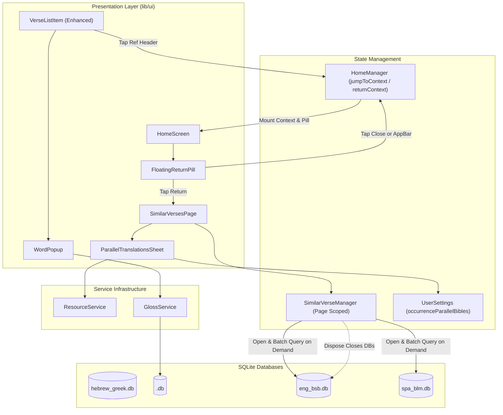

# Word Study Occurrences Enhancement

*   **Author:** suragch
*   **Status:** Approved
*   **Date:** 2026-11-04

--------------------------------------------------------------------------------

## Overview

This design enhances the word occurrence search screen (`SimilarVersesPage`) and main reader workspace (`HomeScreen`) in Global Bible Tools. When conducting lexical studies, users frequently jump between examining a word's distribution across the biblical corpus and reading specific verses in full literary context.

The enhancement enables users to:
1. Tap individual Hebrew or Greek words within occurrence search results to inspect their localized lexical gloss.
2. Jump directly into the full literary context of any occurrence verse on the main reader screen while keeping a floating return pill docked to the screen to return to their search place.
3. Compare occurrence verses alongside one or more downloaded Bible translations (e.g., English, Spanish, French) displayed in parallel directly beneath each occurrence.

--------------------------------------------------------------------------------

## Problem Statement

Currently, `SimilarVersesPage` operates as an isolated list of verse snippets:
*   **No Word Inspection in Results**: Verses are rendered as static text spans. Users cannot tap surrounding original language words to inspect their glosses; looking up an unfamiliar surrounding word requires exiting the occurrence search entirely.
*   **Context Disconnection**: Users who want to read the wider narrative context, listen to audio narration, or inspect surrounding syntax cannot jump from an occurrence item to the main reader screen. Navigating manually requires memorizing the reference, dismissing the search, opening the reference picker, and finding the verse again—losing the search list and scroll progress.
*   **No Translation Comparison**: The occurrence list only displays original Hebrew/Greek text. Users studying how a specific Hebrew or Greek lemma is translated across different contexts cannot view translations in-place. Instead, they must manually cross-reference external Bibles or navigate back and forth one verse at a time.

--------------------------------------------------------------------------------

## Goals & Non-Goals

### Goals
*   **In-Place Word Glosses**: Enable tapping on Hebrew and Greek words in occurrence search results to display the existing `WordPopup` gloss bubble.
*   **Context Jumping**: Make verse reference headers in the occurrence list tappable, navigating the user directly to that verse in `HomeScreen` while dismissing intermediate dialog routes.
*   **Stateful Return Pill**: Display a floating return pill on `HomeScreen` containing the searched lemma and a close button (`✕`). Tapping the pill returns the user to `SimilarVersesPage` with search parameters and scroll position restored.
*   **Deterministic Pill Dismissal**: Dismiss the return pill when the user taps its close button (`✕`) or selects a new passage via the `HomeAppBar` reference chooser.
*   **Parallel Translations View**: Provide a modal multi-select sheet to display one or more downloaded Bible translations beneath each occurrence verse.
*   **Catalog Onboarding**: Display available catalog Bibles in the translation selector, allowing users to download uninstalled translations directly from the sheet.
*   **Query Performance & Isolation**: Ensure multi-translation queries execute without thrashing `BibleService`'s active connection and without degrading list scroll frame rates.

### Non-Goals
*   **Word-Level Translation Alignment**: Highlighting corresponding English or translated words in parallel Bible text is out of scope. Translation verses will render as plain formatted text.
*   **Complex Gesture Hierarchies**: Long-press gestures on occurrence verses or individual words are excluded to prevent gesture collisions and accidental triggers.
*   **Versification Divergence Reconciliation**: Mapping divergent verse numberings across ancient versions (e.g., Septuagint or Vulgate versification differences vs. Masoretic Text [MT]) is deferred to future milestones.
*   **Offline Translation Synthesis**: Automated neural machine translation or dynamic gloss generation.

--------------------------------------------------------------------------------

## Risks & Mitigations

| Risk | Impact | Mitigation |
| --- | --- | --- |
| **SQLite Host Parameter Overflow** | Concordance searches for high-frequency words (e.g., H1732 *David* with 1,000+ occurrences) can exceed SQLite's variable limit (`SQLITE_MAX_VARIABLE_NUMBER`, default 999), causing runtime crashes. | `BibleDatabase.getVerses` partitions reference lists into chunks of $\le 500$ parameters before executing SQL `IN` queries. |
| **SQLite Connection Locks on Deletion** | Holding long-lived database connections to installed Bibles locks `.db` files on Windows, Android, and iOS, causing `EBUSY` deletion errors if a user uninstalls a translation. | Do not maintain a global permanent connection pool. Scope open `BibleDatabase` handles to `SimilarVerseManager`'s page lifecycle; close and dispose connections in `SimilarVerseManager.dispose()`. |
| **Gesture Arena Memory Leaks** | Attaching unmanaged `TapGestureRecognizer` instances to `TextSpan` children in virtualized lists without `AutomaticKeepAliveClientMixin` leaks native recognizers on scroll. | Use `TapGestureRecognizer(onTapDown: (details) => ...)` with explicit lifecycle disposal in `VerseListItemState.dispose()`, capturing coordinates directly from `details.globalPosition`. |
| **Navigation Stack Unwinding Race** | Rapid double-tapping on a verse reference header could trigger concurrent `Navigator.popUntil` invocations or state collisions. | Guard reference header taps with an `isNavigating` lock flag in `SimilarVersesPageState` before executing the pop transition. |
| **Cross-Book Context Loading Mismatch** | Jumping from an occurrence in one biblical book (e.g., Ruth 4) while `HomeScreen` is displaying another (e.g., Genesis 1) cannot simply scroll existing slivers. | In `HomeManager.jumpToContextReference`, check if `targetRef.bookId` or `chapter` differs from `currentReference`. If so, update `currentReference` and `panelAnchorNotifier` to re-mount the target chapter before initiating the verse scroll. |

--------------------------------------------------------------------------------

## Critical User Journeys (CUJs)

### CUJ 1: Inspecting Surrounding Vocabulary within Occurrence Results
*   **Given**: A user is viewing occurrence search results for Strong's code H1732 (*David*) on `SimilarVersesPage`.
*   **When**: The user taps an unfamiliar Hebrew word (e.g., `וַתִּקְרֶאנָה`) within Ruth 4:17.
*   **Then**: A floating `WordPopup` appears anchored at the tapped word position, displaying its localized gloss and grammatical tags. Tapping outside or scrolling the list dismisses the popup without navigating away.

### CUJ 2: Jumping to Full Context and Returning to Search
*   **Given**: A user is scrolling through occurrence results for H1732 and identifies Ruth 4:17.
*   **When**: The user taps the reference header "Ruth 4:17".
*   **Then**: The view unwinds to `HomeScreen`. `HomeManager` verifies the target book and chapter, updates the reader to Ruth 4:17, and scrolls `HebrewGreekPanel` to the verse. A floating return pill labeled "דָּוִד ✕" mounts in `HomeScreen`.
*   **When**: The user finishes reading Ruth 4 and taps the return pill.
*   **Then**: `SimilarVersesPage` re-opens with the searched lemma and filters intact, and the list scrolls to Ruth 4:17.

### CUJ 3: Viewing Parallel Translations for Cross-Linguistic Comparison
*   **Given**: A user is reviewing occurrences on `SimilarVersesPage` and wants to see how the phrase is translated into English and Spanish.
*   **When**: The user taps the "Parallel" selector button and checks "English (Berean Standard Bible)" and "Spanish (Berean Literal Movement [BLM])".
*   **Then**: Each occurrence item displays the Hebrew verse followed by the English and Spanish translations formatted underneath with badges `[BSB]` and `[BLM]`. The selection persists across subsequent occurrence searches.

--------------------------------------------------------------------------------

## Proposed Architecture

### Architectural Overview



---

### 1. Context Navigation Coordination via `HomeManager`

To eliminate the need for a global session singleton and avoid fragile scroll-distance heuristics:

*   **Location**: [`lib/ui/home/home_manager.dart`](file:///Users/suragch/Dev/ethnosdev/gbt/studyapp/lib/ui/home/home_manager.dart)
*   **State Stored**:
    ```dart
    class OccurrenceSearchContext {
      final WordDetails word;
      final SearchType searchType;
      final Reference anchorReference;

      OccurrenceSearchContext({
        required this.word,
        required this.searchType,
        required this.anchorReference,
      });
    }
    ```
*   **Navigation & Lifecycle Methods**:
    - `ValueNotifier<OccurrenceSearchContext?> searchContextNotifier`: Notifies `HomeScreen` when a return pill should be mounted or unmounted.
    - `void jumpToContextReference(OccurrenceSearchContext context)`:
      1. Sets `searchContextNotifier.value = context`.
      2. Compares `context.anchorReference` against `currentReference`. If book or chapter differ, updates `currentReference` and `panelAnchorNotifier` to re-mount the active passage.
      3. Invokes `syncController.updatePosition('manager', ref.bookId, ref.chapter, 0.0, verse: ref.verse)` to scroll `HebrewGreekPanel` to the target verse.
    - `void clearSearchContext()`: Sets `searchContextNotifier.value = null`, unmounting `FloatingReturnPill`.
*   **Deterministic Dismissal**:
    - Tapping the `✕` close button on `FloatingReturnPill` calls `manager.clearSearchContext()`.
    - Navigating to any new book or chapter via `HomeAppBar` calls `manager.clearSearchContext()`.
    - Dropping $\pm 1$ chapter scroll monitoring and route observers eliminates self-dismissal race conditions and eliminates dependencies on `MaterialApp` route observers.

---

### 2. Floating Return Pill (`FloatingReturnPill`)

*   **Location**: `lib/ui/home/floating_return_pill.dart`
*   **Placement**: Mounted inside `HomeScreen`'s root stack, anchored above bottom audio controls / safe area.
*   **Visual Layout**: Compact rounded card displaying the lemma text (e.g., `דָּוִד`), a return arrow icon, and a close icon (`✕`).
*   **Interactions**:
    - **Tap Body**: Pushes `SimilarVersesPage(word: context.word, searchType: context.searchType, anchorReference: context.anchorReference)` onto the navigator stack.
    - **Tap Close (`✕`)**: Invokes `homeManager.clearSearchContext()`.

---

### 3. Parallel Translation Batch Querying via `BibleDatabase`

Rather than introducing a separate singleton service with permanent open database connections, extend the existing [`BibleDatabase`](file:///Users/suragch/Dev/ethnosdev/gbt/studyapp/lib/services/bible/bible_database.dart):

*   **Location**: `lib/services/bible/bible_database.dart`
*   **Batch Query Method**:
    ```dart
    Future<Map<Reference, String>> getVerses(List<Reference> references) async {
      if (references.isEmpty) return {};
      // Chunk into batches of <= 500 to stay within SQLITE_MAX_VARIABLE_NUMBER
      final chunks = _chunkReferences(references, 500);
      final results = <Reference, String>{};
      for (final chunk in chunks) {
        final placeholders = List.filled(chunk.length, '?').join(',');
        final packedInts = chunk.map((r) => r.toPackedInt).toList();
        final rows = await _db.rawQuery(
          'SELECT reference, text, format FROM bible '
          'WHERE reference IN ($placeholders) '
          "AND format NOT IN ('s', 's1', 's2', 'ms', 'mr', 'r', 'd', 'rem') "
          'ORDER BY _id ASC',
          packedInts,
        );
        // Group by reference, joining multi-row poetic lines with a single space ' '
        for (final row in rows) {
          final ref = Reference.fromPackedInt(row['reference'] as int);
          final text = row['text'] as String;
          results[ref] = results.containsKey(ref) ? '${results[ref]} $text' : text;
        }
      }
      return results;
    }
    ```
*   **Lifecycle Scoping**:
    - Database instances are opened via `BibleDatabase.open(path)` within `SimilarVerseManager` using verified file paths from `getIt<ResourceService>().getResourceLocalPath(ResourceType.bible, bibleId)`.
    - All opened `BibleDatabase` handles are closed and cleared in `SimilarVerseManager.dispose()`. This eliminates permanent connection holding and avoids file lock collisions during translation deletion.

---

### 4. Word Gloss Tap Handling

*   **Location**: `lib/ui/common/verse_list_item.dart`
*   **Gesture Capture**:
    - Attach a `TapGestureRecognizer` to each word's `TextSpan`:
      `recognizer = TapGestureRecognizer()..onTapDown = (details) => _onWordTap(context, details.globalPosition, wordId)`
    - Recognizers are stored and disposed within `VerseListItemState.dispose()` to prevent gesture arena leaks.
*   **Gloss Display**:
    - `_onWordTap` invokes `await getIt<GlossService>().glossForId(wordId: wordId)`. If `result?.gloss` is null or empty, the tap is a no-op.
    - If valid, mounts `WordPopup` anchored at `details.globalPosition`.
    - Auto-dismisses on outside tap or when the list emits a scroll notification.

---

### 5. Multi-Select Parallel Selector (`ParallelTranslationsSheet`)

*   **Location**: `lib/ui/home/word_details_dialog/similar_verses/parallel_translations_sheet.dart`
*   **Trigger**: An action button in `SimilarVersesPage`'s header: `Parallel (N)` displaying the active count.
*   **Content**: Modal bottom sheet displaying available Bible translations retrieved from `ResourceService`:
    - Installed translations with checked/unchecked status.
    - Uninstalled translations with download size indicator.
*   **Download Flow**: Tapping an uninstalled translation invokes `getIt<ResourceService>().downloadResource(...)` directly with local progress state tracking.
*   **Persistence**: Active translation IDs are stored in `UserSettings` under `occurrenceParallelBibles` (`List<String>`). Sanitization occurs lazily when opening the sheet or initializing `SimilarVerseManager`.

--------------------------------------------------------------------------------

## Alternatives Considered

### Alternative A: Edge-Docked Horizontal Swipe Tab
*   **Description**: Anchoring a tab flush against the right display edge that requires swiping outward to the edge to dismiss.
*   **Pros**: Direct visual match to preliminary mockup sketches.
*   **Cons**:
    - Directly collides with Android 10+ and iOS system-level edge-swipe back navigation gestures.
    - In Hebrew Scripture (books 1–39), text flows Right-to-Left (RTL); a right-docked tab directly obscures the start of Hebrew verse lines.
    - Violates WCAG 2.5.1 pointer gesture guidelines by failing to provide a single-point alternative to dragging/swiping.
*   **Reason for Rejection**: Severe platform gesture conflicts, accessibility shortcomings, and text occlusion in Hebrew reading mode.

### Alternative B: Inline Horizontal Dropdown for Parallel Translations
*   **Description**: Placing an inline `DropdownButton` horizontally adjacent to the `Root / Exact` segmented control.
*   **Pros**: Keeps the control visible on the primary app bar.
*   **Cons**:
    - Insufficient horizontal width on standard 360–400dp mobile viewports, especially when localized into languages with longer word lengths.
    - Inadequate tap target area and lacks UI space to display download progress bars, file sizes, or language groupings.
*   **Reason for Rejection**: Layout overflow on mobile viewports and poor multi-selection ergonomics.

### Alternative C: Reusing Global `BibleService` for Parallel Queries
*   **Description**: Querying translation texts directly through the existing `getIt<BibleService>()` singleton.
*   **Pros**: Avoids opening separate `BibleDatabase` connections.
*   **Cons**:
    - `BibleService` maintains only a single active SQLite database connection (`_db`, `currentBibleId`). Querying multiple translations repeatedly closes and re-opens SQLite database handles on every rendered list item, causing excessive file I/O and UI thread blocking.
    - Mutating `currentBibleId` breaks the state of the active translation pane (`BiblePanel`) in `HomeScreen`.
    - `BibleDatabase` only supports full-chapter retrieval (`getChapter`), lacking verse-level batch querying.
*   **Reason for Rejection**: Architectural collision with the primary reader and excessive connection thrashing.

### Alternative D: Dedicated Global Session Singleton & RouteObserver
*   **Description**: Creating a permanent `OccurrenceSearchSessionManager` singleton in `GetIt`, registering a global `RouteObserver` in `main.dart`, and tracking chapter distance ($\pm 1$) to auto-dismiss the return pill.
*   **Pros**: Automatically detects secondary route pushes.
*   **Cons**:
    - Compounding complexity: requires global route observers, initialization flags to prevent self-dismissal on programmatic context jumps, and distance math across chapter bounds.
    - Fails cross-book boundary evaluation (navigating to Chapter 1 of another book satisfies $|1 - 1| \le 1$).
    - Introduces unnecessary global state and memory retention for transient searches.
*   **Reason for Rejection**: Accidental complexity spiral; explicit close (`✕`) and `HomeAppBar` navigation triggers provide deterministic, bug-free lifecycle management using existing `HomeManager` infrastructure.

### Alternative E: Token-Level Alignment & Highlighting in Translation Text
*   **Description**: Highlighting corresponding translated words in English or foreign Bible text.
*   **Pros**: Closer visual parallel to original language highlighting.
*   **Cons**:
    - Downloaded Bible databases (`eng_bsb.db`, etc.) contain raw verse text without word-alignment tags or Strong's links.
    - Naive string matching against lexical glosses produces false positives or false negatives.
    - Requires training and bundling offline word alignment models, which is disproportionately complex for this feature.
*   **Reason for Rejection**: Unachievable without extensive offline alignment datasets or high error rates.

### Alternative F: Raw Pixel Scroll Offset Restoration
*   **Description**: Storing `ScrollController.offset` in raw pixels to restore scroll position upon return from context navigation.
*   **Pros**: Standard implementation pattern for static-height lists.
*   **Cons**:
    - Asynchronous multi-translation rendering and dynamic typography scaling make verse item heights variable and unpredictable prior to layout.
    - Restoring raw pixel offsets before items render causes scroll offset clamping and visual layout jumps.
*   **Reason for Rejection**: Layout jumps on variable-height lists; navigating by target `anchorReference` using native list positioning is deterministic and reliable.

--------------------------------------------------------------------------------

## Non-Functional Requirements

### Performance & Latency
*   **Batching & Query Windows**: `BibleDatabase.getVerses` must fetch verses in bulk windows (e.g., 30–50 items per query) rather than individual $N \times M$ queries, ensuring scrolling remains at 60 fps without frame drops.
*   **Recycling & Memory**: `VerseListItem` must allow off-screen item recycling without keeping thousands of `TextSpan` and `TextPainter` trees pinned in memory.

### Rollout & Backward Compatibility
*   **Settings Invariance**: Persisted `occurrenceParallelBibles` must initialize lazily as an empty list (`[]`) without requiring a destructive `settingsVersion` migration.
*   **Lazy Resource Sanitization**: Stored parallel IDs are validated against installed Bibles when the translation sheet opens or when `SimilarVerseManager` initializes; missing or uninstalled translation IDs are pruned without raising exceptions.
*   **Database Invariance**: All queries must remain read-only against existing `BibleSchema` SQLite tables without requiring schema updates or migrations on client devices.

--------------------------------------------------------------------------------

## Detailed Implementation Plan

The implementation is partitioned into five sequential phases with compile and test verification checkpoints between each phase.

---

### Phase 1: Storage & Database Access

#### Target 1: `lib/services/bible/bible_database.dart` (Modify)
*   **Action**: Extend `BibleDatabase` with batch verse querying.
*   **Changes**:
    - Implement `Future<Map<Reference, String>> getVerses(List<Reference> references)`.
    - Chunk input references into batches of $\le 500$ to respect SQLite host parameter limits.
    - Query `BibleSchema.bibleTextTable` using SQL `IN (...)`, filtering out section headers (`s`, `s1`, `s2`, `ms`, `mr`, `r`, `d`, `rem`).
    - Concatenate multi-row poetic lines for a single verse reference using a single space `' '` delimiter.

#### Target 2: `lib/common/reference.dart` (Modify)
*   **Action**: Add packed integer encoding and decoding helpers to `Reference`.
*   **Changes**:
    - Add `int get toPackedInt => bookId * 1000000 + chapter * 1000 + verse;`.
    - Add `factory Reference.fromPackedInt(int packed)`.

#### Target 3: `lib/services/settings/user_settings.dart` (Modify)
*   **Action**: Persist parallel translation selection without startup race conditions.
*   **Changes**:
    - Add preference key `'occurrence_parallel_bibles'`.
    - Add getter `List<String> get occurrenceParallelBibles`.
    - Add setter `Future<void> setOccurrenceParallelBibles(List<String> bibles)`.
    - Do not import or call `ResourceService` in `UserSettings.init()`.

#### Target 4: `test/services/bible/bible_database_test.dart` (Modify)
*   **Action**: Unit test batch verse querying.
*   **Test Cases**:
    - `getVerses with empty reference list returns empty map`
    - `getVerses queries single verse correctly`
    - `getVerses joins multi-row poetic lines with space`
    - `getVerses partitions lists exceeding 500 references into multiple queries`
    - `getVerses filters out section headers (s1, s2)`

> [!NOTE]
> **Phase 1 Checkpoint**: Run `flutter test test/services/bible/` and `flutter analyze lib/services/bible/ lib/common/reference.dart`. All tests must pass with zero analyzer warnings.

---

### Phase 2: Navigation & Context Coordination

#### Target 5: `lib/ui/home/home_manager.dart` (Modify)
*   **Action**: Coordinate context jump and return pill lifecycle on the existing home manager.
*   **Changes**:
    - Define data class `OccurrenceSearchContext` holding `word`, `searchType`, and `anchorReference`.
    - Add `final ValueNotifier<OccurrenceSearchContext?> searchContextNotifier = ValueNotifier(null);`.
    - Add `void jumpToContextReference(OccurrenceSearchContext context)`:
      * Set `searchContextNotifier.value = context`.
      * Compare `context.anchorReference` with `currentReference`. If book or chapter differ, update `currentReference` and `panelAnchorNotifier` to re-mount the reader at the target book/chapter.
      * Invoke `syncController.updatePosition('manager', ref.bookId, ref.chapter, 0.0, verse: ref.verse)`.
    - Add `void clearSearchContext()`: Sets `searchContextNotifier.value = null`.
    - In `updateReference()`, if navigation originates from user AppBar selection, call `clearSearchContext()`.

#### Target 6: `lib/ui/home/floating_return_pill.dart` (Create)
*   **Action**: Build floating return pill widget.
*   **Changes**:
    - Render compact card displaying `context.word.word`, a return arrow, and a close button (`✕`).
    - On tap body: push `SimilarVersesPage` passing `anchorReference: context.anchorReference`.
    - On tap close: call `homeManager.clearSearchContext()`.

#### Target 7: `lib/ui/home/home.dart` (Modify)
*   **Action**: Mount `FloatingReturnPill` in reader stack.
*   **Changes**:
    - Wrap `FloatingReturnPill` in `ValueListenableBuilder<OccurrenceSearchContext?>` listening to `manager.searchContextNotifier`.
    - Mount inside root `Stack` above the bottom audio controls when context is non-null.

#### Target 8: `test/ui/home/floating_return_pill_test.dart` (Create)
*   **Action**: Widget tests for floating return pill.
*   **Test Cases**:
    - `Pill renders lemma text and close icon when context is active`
    - `Tapping close icon invokes clearSearchContext`
    - `Tapping pill body triggers return navigation`

#### Target 9: `test/ui/home/home_manager_test.dart` (Modify)
*   **Action**: Test context jump and dismissal logic.
*   **Test Cases**:
    - `jumpToContextReference updates searchContextNotifier and scrolls reader`
    - `jumpToContextReference across different books switches currentReference`
    - `clearSearchContext resets notifier to null`
    - `updateReference from AppBar dismisses active search context`

> [!NOTE]
> **Phase 2 Checkpoint**: Run `flutter test test/ui/home/` and verify clean build and passing tests.

---

### Phase 3: In-Place Word Gloss Tapping

#### Target 10: `lib/ui/home/panel_area/hebrew_greek_panel/text.dart` (Modify)
*   **Action**: Export or decouple `WordPopup` widget for shared usage across reader and occurrence list.

#### Target 11: `lib/ui/common/verse_list_item.dart` (Modify)
*   **Action**: Support tappable reference headers, word gloss tapping, and parallel verse rendering.
*   **Changes**:
    - Constructor signature update:
      ```dart
      const VerseListItem({
        super.key,
        required this.verseContentFuture,
        required this.formattedReference,
        required this.textDirection,
        this.onReferenceTapped,
        this.parallelVerses,
      });
      final VoidCallback? onReferenceTapped;
      final List<ParallelVerseData>? parallelVerses;
      ```
    - Wrap reference header in `GestureDetector(onTap: onReferenceTapped)`.
    - Attach `TapGestureRecognizer(onTapDown: (details) => ...)` to original language word `TextSpan`s.
    - Query `await getIt<GlossService>().glossForId(wordId: wordId)`.
    - Mount `WordPopup` anchored at `details.globalPosition`.
    - Auto-dismiss popup on list scroll notification or outside tap.
    - Render `parallelVerses` beneath original text in distinct styled cards with translation badges (`[BSB]`, `[BLM]`).
    - Remove `AutomaticKeepAliveClientMixin` to enable viewport recycling.

> [!NOTE]
> **Phase 3 Checkpoint**: Run `flutter analyze lib/ui/common/verse_list_item.dart` and `flutter test test/ui/common/`.

---

### Phase 4: Occurrence List & Parallel Translations

#### Target 12: `lib/ui/home/word_details_dialog/similar_verses/similar_verse_manager.dart` (Modify)
*   **Action**: Manage page-scoped `BibleDatabase` connections and parallel verse fetching.
*   **Changes**:
    - Manage active `Map<String, BibleDatabase> _translationDbs`.
    - On search or parallel selection change, resolve database paths via `getIt<ResourceService>().getResourceLocalPath(ResourceType.bible, id)` and open `BibleDatabase.open(path)`.
    - Fetch parallel verses via `db.getVerses(references)` in batches.
    - Close all `_translationDbs` in `dispose()`.
    - Expose `ValueNotifier<Map<Reference, List<ParallelVerseData>>> parallelVersesNotifier`.

#### Target 13: `lib/ui/home/word_details_dialog/similar_verses/parallel_translations_sheet.dart` (Create)
*   **Action**: Modal bottom sheet for selecting parallel translations.
*   **Changes**:
    - Query installed and catalog Bible translations via `ResourceService`.
    - Render checkbox tiles for installed translations.
    - Render downloadable translations with download button; tapping initiates `getIt<ResourceService>().downloadResource(...)` with inline progress state.
    - Save selection to `UserSettings.setOccurrenceParallelBibles(...)`.

#### Target 14: `lib/ui/home/word_details_dialog/similar_verses/similar_verses_page.dart` (Modify)
*   **Action**: Integrate parallel button, reference tap navigation, and scroll restoration.
*   **Changes**:
    - Constructor parameter: `final Reference? anchorReference;`.
    - Header row: Add `Parallel (N)` action chip opening `ParallelTranslationsSheet`.
    - On reference header tap:
      * Construct `OccurrenceSearchContext(word: widget.word, searchType: activeSearchType, anchorReference: tappedRef)`.
      * Call `homeManager.jumpToContextReference(context)`.
      * Call `Navigator.popUntil(context, (route) => route.isFirst)`.
    - Scroll restoration: If `anchorReference != null`, once `similarVersesNotifier` resolves, find `index = results.indexOf(anchorReference)`. After frame layout, scroll to item via `Scrollable.ensureVisible` or item scroll offset.

#### Target 15: `test/ui/home/word_details_dialog/similar_verses/similar_verses_page_test.dart` (Create)
*   **Action**: Widget tests for occurrence search page enhancements.
*   **Test Cases**:
    - `Tapping reference header calls jumpToContextReference and unwinds navigation`
    - `Tapping word span queries GlossService and displays WordPopup`
    - `Parallel translations sheet lists installed Bibles and toggles selection`
    - `Opening with anchorReference triggers scroll restoration to target verse`

> [!NOTE]
> **Phase 4 Checkpoint**: Run `flutter test test/ui/home/word_details_dialog/similar_verses/` and verify all tests pass.

---

### Phase 5: Documentation & End-to-End Verification

#### Target 16: Documentation Contracts (Modify)
*   [`lib/services/bible/README.md`](file:///Users/suragch/Dev/ethnosdev/gbt/studyapp/lib/services/bible/README.md): Document `BibleDatabase.getVerses` batch query interface and chunking invariants.
*   [`lib/ui/home/README.md`](file:///Users/suragch/Dev/ethnosdev/gbt/studyapp/lib/ui/home/README.md): Document `FloatingReturnPill` and `HomeManager` context navigation coordination.
*   [`lib/ui/home/word_details_dialog/similar_verses/README.md`](file:///Users/suragch/Dev/ethnosdev/gbt/studyapp/lib/ui/home/word_details_dialog/similar_verses/README.md): Document parallel translation lifecycle and `ParallelTranslationsSheet`.

---

## Verification Plan

### Automated Verification
*   **Static Analysis**: `flutter analyze` (Zero errors, zero warnings).
*   **Unit & Widget Test Suite**: `flutter test` (All existing and new test suites pass).

### Manual Walkthrough Verification
1.  **CUJ 1 (Gloss Tapping)**: Open occurrence search for H1732; tap individual words in Ruth 4:17; verify `WordPopup` displays localized gloss and auto-dismisses on outside tap or scroll.
2.  **CUJ 2 (Context Jump & Return)**: Tap "Ruth 4:17" reference header; verify reader unwinds to `HomeScreen` and scrolls to Ruth 4:17; verify floating return pill appears; scroll to Ruth 4:18 (pill remains); navigate to Genesis 1 via AppBar (pill dismisses); re-open search and tap Ruth 4:17; tap pill and verify search re-opens positioned at Ruth 4:17.
3.  **CUJ 3 (Parallel Translations)**: Open "Parallel" sheet; select English BSB and Spanish BLM; verify translations render beneath Hebrew verses with badges `[BSB]` and `[BLM]`; verify selection persists across app relaunch.
